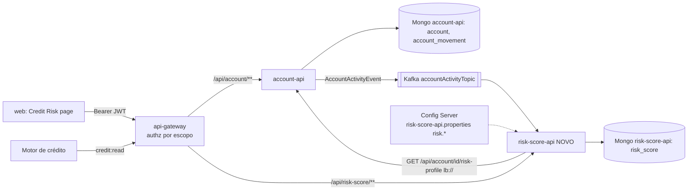

# 2.6 Domain Design — Componentes (INT-1)



| Componente | Responsabilidade | Mudança |
|---|---|---|
| **account-api** | Dono dos dados de conta: `openedAt`, KYC, ledger `account_movement`, perfil de risco agregado (`risk-profile`), publica `AccountActivityEvent` | Alterado (aditivo) |
| **risk-score-api** (novo módulo Maven) | Consome eventos, busca `risk-profile`, calcula score por regras (`RiskScoreCalculator` puro), grava histórico imutável, expõe consulta/histórico/recálculo, métricas | Novo |
| **api-gateway** | Rota `/api/risk-score/**`; autorização por escopo (`credit:read`/`credit:write`) para score e KYC | Alterado |
| **config-files** | `risk-score-api.properties` com `risk.params.*` versão `v1` (valores aprovados) | Novo arquivo |
| **web** | Rota `/credit-risk` (lista contas → detalhe com score, fatores, histórico, KYC, recalcular), client + mocks MSW | Alterado |

## Modelo de dados
**account (Mongo, account-api)** — novos campos opcionais: `openedAt: Instant`, `kyc: { status: VALID|PENDING|EXPIRED, validUntil: LocalDate, updatedAt: Instant }`.

**account_movement (Mongo, account-api)** — `{ id, accountId, type: DEPOSIT, amount: BigDecimal, currency, occurredAt: Instant }`, índice `(accountId, occurredAt desc)`.

**risk_score (Mongo db `risk-score-api-mongo`)** — documento imutável por cálculo: `{ id, accountId, score, band, mode: SHADOW, paramsVersion, trigger, sourceEventId, factors[], inputs{}, calculatedAt }`; índices `(accountId, calculatedAt desc)` e único `(accountId, sourceEventId)` (idempotência, NFR-6).

## Algoritmo (parâmetros aprovados v1, sempre lidos de `risk.params.*`)
```
saldoBRL  = balance * rate[currency]          // sem taxa → fatores Saldo/Volume = 0, "taxa ausente"
volumeBRL = sum(movements[last windowDays].amount) * rate[currency]
freq      = count(movements[last windowDays])
months    = monthsBetween(openedAt, now)      // openedAt null → 0, "dado ausente"
kyc       = VALID && validUntil-today > 30d → 150 ; VALID && ≤30d → 75 ; else 0 (ausente → "dado ausente")
pontos(f) = pontos da primeira faixa cujo limite inferior ≤ valor (faixas em config)
score     = Σ pontos  (0..1000) ; band = HIGH(0–399) | MEDIUM(400–699) | LOW(700–1000)
```
