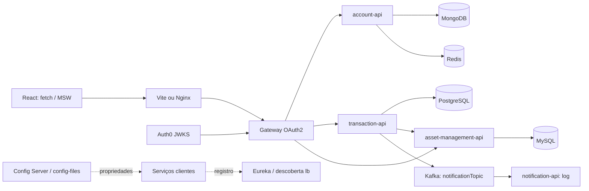

# 2.1 — Engenharia reversa (RRB-1)

Estado inspecionado: `6f7ec3c`; leitura estimada: 3 min. Referências relativas à raiz. Nas referências Java, **A** = `account-api/src/main/java/com/royal/reserve/bank/account/api`, **T** = `transaction-api/src/main/java/com/royal/reserve/bank/transaction/api`, **N** = `notification-api/src/main/java/com/royal/reserve/bank/notification/api`, **G** = `api-gateway/src/main/java/com/royal/reserve/bank/api/gateway`.

## Arquitetura atual

- Spring Boot 3 / Spring Cloud; sete módulos (`pom.xml:7-35`). Conta usa MongoDB; transação usa PostgreSQL; ativos usam MySQL (`config-files/account-api.properties:2`, `config-files/transaction-api.properties:2-6`, `config-files/asset-management-api.properties:2-6`). Notification apenas registra o evento recebido (`N/NotificationApiApplication.java:25-27`).
- Gateway roteia por `lb://` para contas/transações/ativos; descoberta usa URI HTTP (`config-files/api-gateway.properties:10-29,40-43`). Eureka registra serviços (`discovery-server/src/main/java/com/royal/reserve/bank/discovery/server/DiscoveryServerApplication.java:10-14`). Transação consulta ativos via Feign (`T/client/AssetManagementClient.java:14-25`).
- Auth0: inicialização decodifica `encodedJwt`, busca chave RSA pelo `kid` no JWKS configurado; OAuth2 Resource Server valida os Bearer recebidos com essa chave. O filtro adicional apenas captura o token. Não há regra por papel/escopo, conversor de claims nem validação explícita de issuer/audience nessa classe: apenas `authenticated()`, exceto descoberta liberada (`G/config/SecurityConfig.java:33-98`, `config-files/api-gateway.properties:7-8`). Não confundir decodificação do token configurado com validação do token da requisição.
- Config Server nativo lê `config-files`, expõe prefixo `/config-server`; clientes importam configuração por nome da aplicação e URI (`config-server/src/main/resources/application.properties:1-6`, `account-api/src/main/resources/application.properties:1-3`). Compose injeta perfil `docker` e URI; monta propriedades, cujo caminho passa a `classpath:config-files` (`docker-compose.yml:7-9,69-80`, `config-server/src/main/resources/application-docker.properties:2`). Não foi demonstrado refresh em runtime.
- Redis: lista `accounts` em cache-aside; criar/depositar/excluir invalida a chave. O `set` manual não aplica TTL, apesar da propriedade de cache (`A/service/AccountService.java:37-46,73-85,98-112,144-146`, `config-files/account-api.properties:7-9`).

## Caminhos afetados e gaps

| Necessidade | Existe → falta para a intenção |
|---|---|
| Abertura | `Account` só tem id, número, titular, saldo, moeda → data + backfill (`A/model/Account.java:16-28`). |
| KYC | Mesmo modelo → status/validade e edição manual; criação hoje só copia dados e gera IBAN (`A/service/AccountService.java:37-46`). |
| Movimentações por conta | Depósito soma saldo, sem registro temporal; transação compra ativos, sem conta/data → ledger de depósitos (`A/service/AccountService.java:98-112`, `T/model/Transaction.java:20-26`, `T/model/TransactionItems.java:19-25`). |
| Evento de movimentação | Kafka existe **em transaction-api**, não em account-api (dependências `account-api/pom.xml:15-46`); evento contém só transactionId → novo contrato/publicação confiável (`T/service/TransactionService.java:58-60`, `T/event/TransactionEvent.java:13-15`). Listener atual só loga (`N/NotificationApiApplication.java:25-27`). |
| Score + histórico | Modelo/persistência atuais não guardam cálculos, fatores ou versão → adicionar armazenamento explicável (`A/model/Account.java:21-28`, `A/service/AccountService.java:121-128`). |
| API de consulta | Controller tem criar/listar/excluir/depositar → leitura do último score e histórico (`A/controller/AccountController.java:31-82`). |
| Perfil Crédito | Apenas autenticação → autorização backend + apresentação restrita (`G/config/SecurityConfig.java:63-67`, `web/src/App.tsx:12-20`). |
| Câmbio BRL | Conta guarda `Currency`, sem conversão no fluxo → taxas configuráveis e taxa aplicada auditável (`A/model/Account.java:27`, `A/service/AccountService.java:107-128`). |
| Pesos | Propriedades atuais só infraestrutura → pesos/limiares versionados (`config-files/account-api.properties:1-12`). |

## Web e execução

Rotas: Dashboard, Contas, Nova transação, Ativos, Configurações e 404; sem login/guard (`web/src/App.tsx:12-20`). Contas usa Query/Mutation e invalida `accounts` após alterações (`web/src/pages/AccountsPage.tsx:28-68`); client cobre criação/depósito (`web/src/api/accounts.ts:9-31`). `apiFetch` usa base URL opcional, senão `/api`; token manual em `rrb.token`/fallback `VITE_API_TOKEN`, enviado Bearer; não há fluxo OAuth interativo (`web/src/api/client.ts:1-29`, `web/src/pages/SettingsPage.tsx:39-50`). Vite encaminha ao gateway local; Nginx ao container (`web/vite.config.ts:7-13`, `web/nginx.conf:8-14`).

MSW intercepta antes do render se `VITE_API_MOCK=true` (padrão dev); handlers simulam contas/depósitos/transações/ativos, sem demonstrar autorização real (`web/src/main.tsx:9-19`, `web/.env.development:1`, `web/src/mocks/handlers.ts:12-64`). Novos contratos exigirão client, mocks e página.

Compose publica gateway 8080, Mongo 27017, MySQL 3306, Config 8888, Eureka 8761, Kafka host 9092/interno 29092, Prometheus 9090, Redis 6379, PostgreSQL 5432, Zipkin 9411 (`docker-compose.yml:15-191,205-209`). **Web e Grafana disputam host 3000** (`docker-compose.yml:99-103,193-200`); APIs usam imagens remotas, não build local (`docker-compose.yml:3-6,166-169`). CI encontrado: somente web, filtrado por caminhos (`.github/workflows/web.yml:1-36`); stack não foi subida nesta inspeção.
