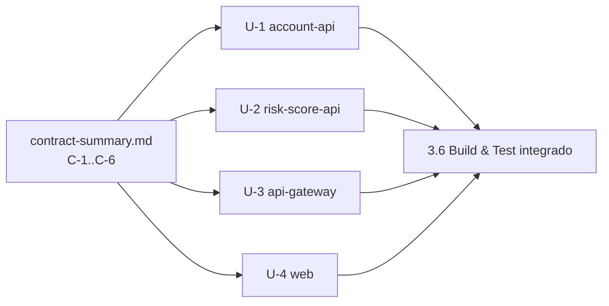

# 2.7 DAG de unidades — INT-1

Dependências de **runtime** (U-2 consome evento/endpoint de U-1; U-4 chama U-2/U-1 via U-3) são resolvidas pelos contratos: cada unidade testa contra stubs (MockWebServer/EmbeddedKafka no backend, MSW no web). Não há dependência de **código** entre unidades → as 4 rodam **em paralelo** (onda única). Conflitos evitados por posse de arquivos (ver `unit-of-work.md`); `pom.xml` raiz é tocado por U-1 (versão) e U-2 (módulo) em linhas distintas.
